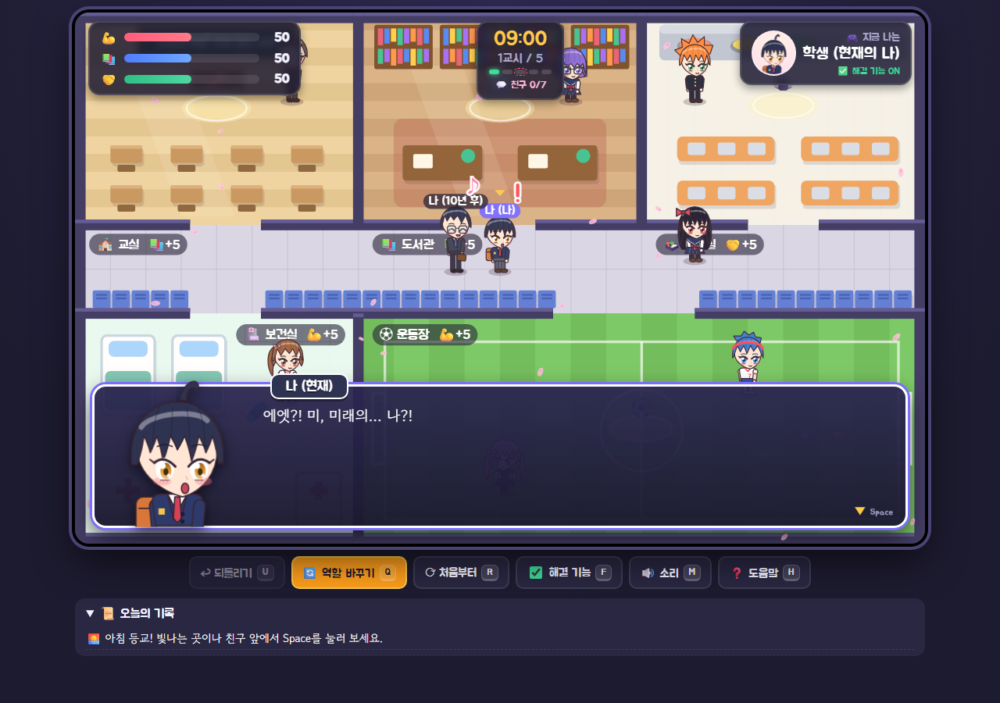

# ⏳ 미래의 나와 하루 학교

> 10년 뒤의 내가 학교에 나타났다. 5교시 동안 학교를 돌아다니며 하루를 보내자.
> 그런데 3교시 종이 울리면… **나와 미래의 나의 역할이 뒤바뀐다?!**

Python(Flask) 백엔드와 HTML5 캔버스로 만든 2D 애니메이션풍 학교 생활 게임입니다.
그림 파일 없이 캐릭터를 모두 코드로 그렸습니다.

## 🌐 바로 플레이하기

**👉 https://gksdnd0519-commits.github.io/future-me-school/**

설치 없이 누구나 브라우저에서 바로 플레이할 수 있어요. 여러 명이 동시에 해도 각자 따로 진행됩니다. (PC 키보드 권장)


| 플레이 | 대화 |
|---|---|
|  |  |

---

## ▶ 실행 방법

```bash
python -m pip install -r requirements.txt   # 처음 한 번만 (Flask 설치)
python 한웅.py                                # 서버가 켜지고 브라우저가 자동으로 열림
```

브라우저가 자동으로 열리지 않으면 `http://127.0.0.1:5000` 으로 들어가세요. 끌 때는 터미널에서 `Ctrl + C`를 누릅니다.
유료 API나 외부 서버 없이 내 컴퓨터에서만 돌아갑니다.

## 🎮 조작법

| 키 | 기능 |
|---|---|
| `W A S D` / 방향키 | 이동 (`Shift`를 누르면 달리기) |
| `Space` / `E` | 빛나는 곳에서는 행동 메뉴, 친구 앞에서는 대화, 대화창에서는 다음 |
| `1` `2` `3` | 메뉴에서 바로 고르기 |
| `U` | 되돌리기 |
| `Q` | 역할 바꾸기 (돌발 상황 재현) |
| `F` | 해결 기능 켜기/끄기 (버그 시연) |
| `R` | 처음부터 |
| `M` / `H` | 소리 켜기/끄기 / 도움말 |

---

## 🧩 과제 조합과 반영한 곳

| 요소 | 뽑은 것 | 반영한 곳 |
|---|---|---|
| 장르 | 자유형 프로그램 | 걸어 다니는 탐험, 행동 메뉴, 대화가 섞인 시뮬레이션 게임 |
| 주어 | 미래의 나 | 10년 뒤의 내가 플레이어를 따라다니며 조언하는 주인공 |
| 공간 | 학교 | 교실·도서관·급식실·보건실·운동장·복도 지도, 친구 7명 |
| 돌발 상황 | 주인공의 역할이 서로 바뀐다 | 3교시에 내가 조종하는 캐릭터가 "현재의 나"에서 "미래의 나"로 바뀜 |

## ✅ 핵심 기능 3개

1. **입력·선택**: 캐릭터를 움직여 장소를 고르고, 행동 메뉴에서 행동을 선택합니다.
2. **상태 변화**: 행동, 장소 보너스, 친구와의 대화에 따라 체력·성적·우정이 바뀝니다. 피로 규칙과 S~C 등급 엔딩이 있습니다.
3. **확인·취소·다시 실행**: 기록창으로 결과를 확인하고, 되돌리기(`U`)와 처음부터(`R`)로 취소하거나 다시 시작합니다.

## 🚨 돌발 상황: 재현과 해결

- **재현**: 3교시 종이 울리면 자동으로 역할이 바뀝니다. `Q` 키로 언제든 바꿀 수도 있습니다.
- **문제**: 역할이 바뀌었는데 버튼이 학생용 그대로라면 "어른이 숙제를 하는" 이상한 일이 생깁니다.
  `F` 키로 해결 기능을 끄면 이 버그를 그대로 볼 수 있습니다 (메뉴가 빨갛게 바뀜).
- **해결** (`web/app.py`):
  - 역할마다 할 수 있는 행동을 따로 정의했습니다 (`ROLES`). 학생은 공부하기/친구 돕기/쉬기, 미래의 나는 힌트 주기/응원하기/경고하기입니다.
  - 서버가 **현재 역할에 맞는 버튼만** 화면에 보냅니다 (`view()`).
  - 화면을 거치지 않고 요청이 와도 서버가 **한 번 더 검사해서 막습니다** (`act()`의 ⛔ 처리).
  - 역할이 바뀌면 화면 위쪽 역할 표시, 조종하는 캐릭터, 친구들의 대사도 함께 바뀝니다.

## 🧪 시험 기록

| # | 시험 | 결과 |
|---|---|---|
| 1 | 교실에서 공부하기 | 성적 +20 (보너스 포함), 체력 −12 ✅ |
| 2 | 2교시가 끝난 뒤 3교시 시작 | 역할이 자동으로 바뀌고 행동 목록이 바뀜 ✅ |
| 3 | 미래의 나 역할로 "공부하기" 요청 | ⛔ 막힘, 점수 변화 없음 ✅ |
| 4 | 해결 기능을 끄고 공부하기 | ⚠️ 버그 재현 (역할과 버튼이 어긋남) ✅ |
| 5 | 체력 14에서 공부하기 | 😵 피로 규칙으로 막힘 ✅ |
| 6 | 복도에서 행동 요청 | 장소 밖이라 막힘 ✅ |
| 7 | 서아와 두 번 대화 | 첫 대화만 우정 +3 ✅ |
| 8 | 5교시 종료 | 등급과 엔딩 표시, 되돌리기 가능 ✅ |
| 9 | 지도 길찾기 검사 | 시작 위치에서 다섯 장소 모두 도달 가능 ✅ |

## 🌐 웹 공개 버전은 어떻게 돌아가나요?

GitHub Pages에서는 파이썬을 실행할 수 없어요. 그래서 공개 주소에서는 `web/app.py`의 규칙을 자바스크립트로 그대로 옮긴
`web/static/local-api.js`가 각자의 브라우저 안에서 규칙을 계산합니다.

- 내 컴퓨터에서 `python 한웅.py`로 실행하면 **파이썬 서버(app.py)**가 규칙을 계산해요.
- 공개 주소로 접속하면 **local-api.js**가 규칙을 계산해요. 진행 상황은 각자의 브라우저에 저장돼요.
- 두 규칙은 같은 시나리오 18단계에서 결과가 모두 같은 것을 확인했어요. 규칙을 고칠 때는 두 파일을 함께 고쳐야 해요.
- `main` 브랜치에 올리면 `.github/workflows/pages.yml`이 `build_site.py`를 실행해서 공개 사이트를 자동으로 다시 배포해요.

## 📁 파일 구조

```
한웅.py               실행기 (서버 켜기 + 브라우저 열기)
build_site.py         웹 공개용 사이트(site/) 만들기
school_sim.py         첫 버전 (tkinter 창 프로그램)
web/
├─ app.py             백엔드: 게임 규칙, 점수, 역할, 되돌리기, 친구 대화
├─ templates/index.html  화면 뼈대
└─ static/
   ├─ anime.js        애니메이션풍 캐릭터 그리기 (도형으로 그림)
   ├─ local-api.js    웹 공개용: app.py 규칙을 브라우저에서 계산
   ├─ game.js         지도, 이동과 충돌, 친구 AI, 대화창, 효과음, 연출
   └─ style.css       꾸미기
```

## 🛠 만든 과정

1. `school_sim.py`: tkinter로 만든 가장 작은 실행 버전 (선택 → 점수 변화)
2. Flask 웹 버전: 백엔드와 화면 분리, 되돌리기·초기화, 역할 바뀜 해결
3. 게임화: 키보드 이동, 학교 지도, 효과음, 연출, 등급 엔딩
4. 캐릭터화: 애니메이션풍 캐릭터, 친구 7명, 비주얼 노벨식 대화창, 벚꽃
