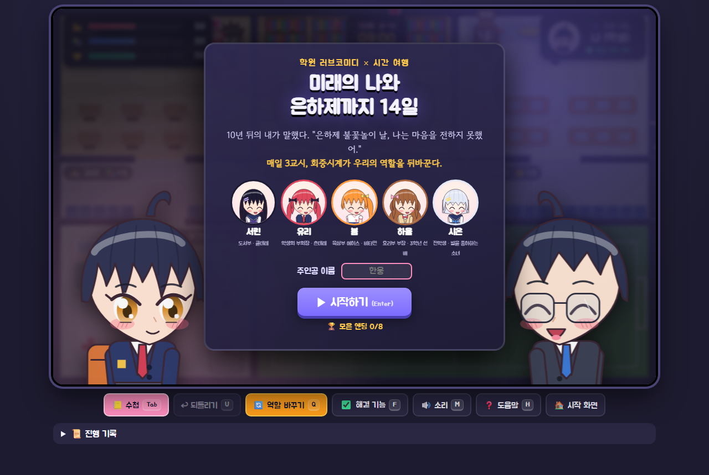
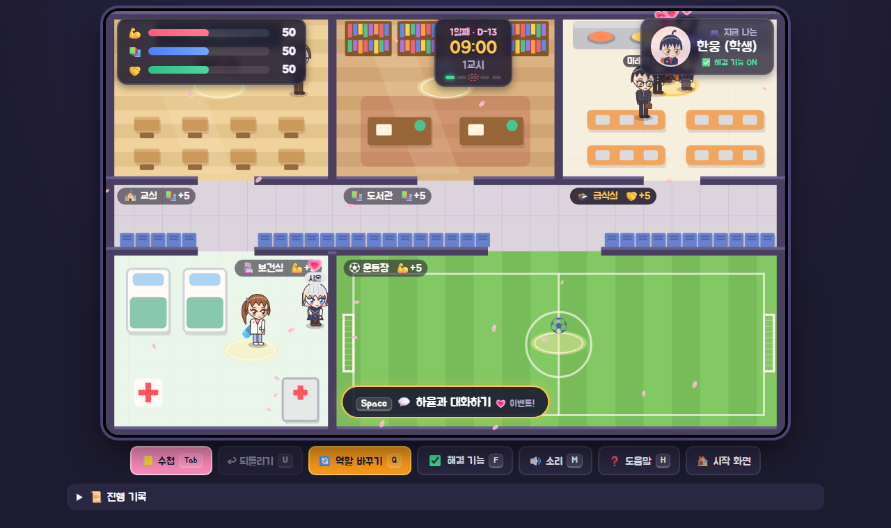
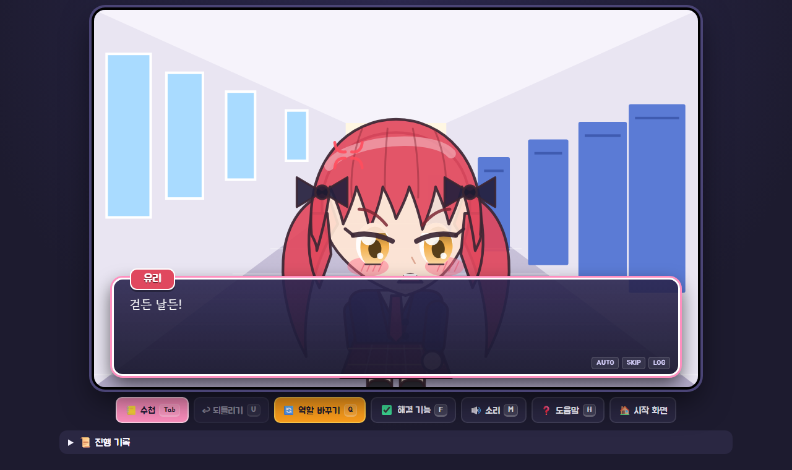

# ⏳ 미래의 나와 은하제까지 14일

> 10년 뒤의 내가 말했다. "은하제 불꽃놀이 날, 나는 마음을 전하지 못했어."
> 축제까지 남은 14일. **매일 3교시, 회중시계가 나와 미래의 나의 역할을 뒤바꾼다.**

학교를 걸어 다니며 히로인 5명과 가까워지는 **학원 러브코미디 미연시(연애 시뮬레이션)**입니다.
Python(Flask) 백엔드와 HTML5 캔버스로 만들었고, 캐릭터와 배경은 그림 파일 없이 모두 코드로 그렸습니다.

## 🌐 바로 플레이하기

**👉 https://gksdnd0519-commits.github.io/future-me-school/**

설치 없이 PC 브라우저에서 바로 플레이할 수 있어요. 진행 상황은 자기 브라우저에 자동 저장되고, 여러 명이 동시에 해도 각자 따로 진행돼요.



| 학교 지도 | 미연시 장면 |
|---|---|
|  |  |


---

## 💗 히로인

| 이름 | 소개 | 자주 있는 곳 | 좋아하는 능력치 |
|---|---|---|---|
| 한서린 | 도서부 · 쿨데레. 몰래 소설을 쓰는데 결말을 못 쓴다 | 도서관 | 📚 성적 |
| 강유리 | 학생회 부회장 · 츤데레. 축제 준비를 혼자 떠안는 완벽주의자 | 교실·복도 | 🤝 우정 |
| 이봄 | 육상부 에이스 · 비타민. 발목 부상을 웃음으로 숨긴다 | 운동장 | 💪 체력 |
| 민하율 | 3학년 요리부 부장. 다정한 선배, 해외 유학을 고민 중 | 급식실 | 🤝 우정 |
| 백시온 | 별을 좋아하는 전학생. 회중시계의 비밀을 유일하게 눈치챈다 | 보건실 | 💪 체력 |

조연: 미래의 나(10년 후), 절친이자 연애 정보통 도윤, 담임 김 선생님, 보건 한 선생님

모든 인물과 이야기는 이 게임을 위해 새로 만든 창작물입니다. "히로인 여러 명이 나오는 학원 러브코미디"라는 장르 분위기만 참고했고, 특정 작품의 캐릭터나 설정은 쓰지 않았습니다.

## 📖 분량

| 대본 | 대사 |
|---|---|
| 공통 (프롤로그, 14일의 아침·밤, 역할 바뀜, 축제, 노멀 엔딩 3종, 조연 잡담) | 533줄 |
| 서린 / 유리 / 봄 / 하율 / 시온 (각각 이벤트 12개 + 엔딩 + 잡담 + 힌트) | 680 / 706 / 684 / 600 / 617줄 |
| **합계** | **3,820줄, 선택지 64개** |

- 엔딩 8종: 히로인 엔딩 5개와 노멀 엔딩 3개(체력/성적/우정)
- 예상 플레이 시간: 한 명 공략에 약 2시간, 5명 모두 보려면 약 8~10시간 (읽는 속도에 따라 달라요)

## ▶ 내 컴퓨터에서 실행

```bash
python -m pip install -r requirements.txt   # 처음 한 번만 (Flask 설치)
python 한웅.py                                # 서버가 켜지고 브라우저가 자동으로 열림
```

진행 상황은 `web/save.json`에 자동 저장돼요. 끌 때는 터미널에서 `Ctrl + C`를 누르세요.

## 🎮 조작법

| 키 | 기능 |
|---|---|
| `W A S D` / 방향키 | 이동 (`Shift` 달리기) |
| `Space` / `E` | 사람 앞에서는 대화, 빛나는 곳에서는 행동, 장면에서는 다음 대사 |
| `1` `2` `3` | 선택지·메뉴 고르기 |
| `A` / `Ctrl` 누르고 있기 / `L` | 자동 진행 / 빨리 넘기기 / 지난 대사 |
| `Tab` | 📒 호감도 수첩 (위치, 하트, 다음 이야기 조건) |
| `U` | 되돌리기 |
| `Q` / `F` | 역할 바꾸기 (돌발 상황 재현) / 해결 기능 켜고 끄기 |
| `M` / `H` | 소리 / 도움말 |

## 💡 공략 방법

1. 히로인은 교시마다 정해진 장소에 있어요. 머리 위에 **💗**가 뜨면 이벤트를 볼 수 있어요. 이벤트를 보면 한 교시가 지나요.
2. 이벤트가 없을 때도 매일 말을 걸면 호감도 +1. 이벤트 속 **선택지**에 따라 호감도가 크게 달라져요.
3. 어떤 이야기는 능력치가 필요해요 (6번째 55, 9번째 62, 12번째 68). 빛나는 곳에서 행동해서 올리세요.
4. **3교시에는 미래의 나**가 돼요. 히로인에게 말을 걸면 공략 힌트를 줘요.
5. 14일째 밤, 이야기 12개를 모두 보고 호감도 60 이상인 히로인 중 가장 높은 사람과 엔딩을 맞아요.

---

## 🧩 과제 조합과 반영한 곳

| 요소 | 뽑은 것 | 반영한 곳 |
|---|---|---|
| 장르 | 자유형 프로그램 | 탐험 + 시뮬레이션 + 비주얼 노벨이 섞인 연애 시뮬레이션 게임 |
| 주어 | 미래의 나 | 후회를 바로잡으러 10년 뒤에서 온 주인공. 14일 내내 함께하며 조언함 |
| 공간 | 학교 | 은하고등학교의 교실·도서관·급식실·보건실·운동장·복도, 축제 |
| 돌발 상황 | 주인공의 역할이 서로 바뀐다 | 매일 3교시에 내가 조종하는 캐릭터가 "현재의 나"에서 "미래의 나"로 바뀜 |

## ✅ 핵심 기능 3개

1. **입력·선택**: 캐릭터를 움직여 장소와 사람을 고르고, 행동 메뉴와 대화 선택지를 고른다.
2. **상태 변화**: 행동, 이벤트, 선택지에 따라 능력치(체력·성적·우정)와 히로인별 호감도가 바뀌고, 이에 따라 이벤트 조건과 엔딩이 달라진다.
3. **확인·취소·다시 실행**: 호감도 수첩과 진행 기록으로 결과를 확인하고, 되돌리기(`U`)와 새 게임으로 취소하거나 다시 시작한다.

## 🚨 돌발 상황: 재현과 해결

- **재현**: 매일 3교시가 되면 자동으로 역할이 바뀌어요 (`Q` 키로 언제든 바꿀 수도 있어요).
- **문제**: 역할이 바뀌었는데 행동 버튼과 연애 이벤트가 학생용 그대로라면, "어른이 숙제를 하거나 고등학생에게 고백하는" 이상한 일이 생겨요. `F` 키로 해결 기능을 끄면 이 버그를 그대로 볼 수 있어요 (메뉴가 빨갛게 바뀜).
- **해결** (`web/app.py`):
  - 역할마다 할 수 있는 일을 나눴어요 (`ROLES`). 학생은 공부하기/친구 돕기/쉬기와 연애 이벤트를, 미래의 나는 힌트 주기/응원하기/경고하기와 공략 힌트를 할 수 있어요.
  - 서버가 **현재 역할에 맞는 버튼만** 화면에 보내요 (`view()`).
  - 화면을 거치지 않은 요청도 서버가 **한 번 더 검사해서 막아요** (`act()`, `meet()`).
  - 역할이 바뀌면 조종하는 캐릭터, 화면 위쪽 역할 표시, 히로인 머리 위 표시(💗 ↔ 💡)가 함께 바뀌어요.

## 🧪 시험 기록

| # | 시험 | 결과 |
|---|---|---|
| 1 | 대본 형식 검사 (`python tools/check_story.py`) | 6개 파일 모두 통과 ✅ |
| 2 | 서린 루트를 14일(70교시) 자동 플레이 | 서린 엔딩 도달, 호감도 99 ✅ |
| 3 | 히로인 5명을 각각 자동 공략 | 5명 모두 이벤트 12/12, 자기 엔딩 도달 ✅ |
| 4 | 파이썬 규칙과 웹용 자바스크립트 규칙 비교 (같은 요청 143개) | 143단계 모두 같은 결과 ✅ |
| 5 | 3교시 시작 / 4교시 시작 | 미래의 나로 바뀜 / 학생으로 돌아옴 ✅ |
| 6 | 미래의 나로 히로인에게 말 걸기 | 연애 이벤트 대신 힌트 ✅ |
| 7 | 해결 기능 끄고 미래의 나로 공부하기 | ⚠️ 버그 재현 (역할과 버튼이 어긋남) ✅ |
| 8 | 체력이 부족한데 공부하기 | 😵 피로 규칙으로 막힘 ✅ |
| 9 | 이벤트 조건 미달 (능력치 부족) 상태에서 말 걸기 | 잡담 + "성적 55 이상 필요" 안내 ✅ |
| 10 | 시작·장면·선택지·지도 화면 캡처 확인 | 정상 표시 ✅ |

## 📁 파일 구조

```
한웅.py                 실행기 (서버 켜기 + 브라우저 열기)
school_sim.py           첫 버전 (tkinter 창 프로그램)
build_site.py           웹 공개용 사이트(site/) 만들기
tools/check_story.py    대본 형식 검사기
web/
├─ app.py               백엔드: 14일 진행, 호감도, 이벤트 조건, 역할 바뀜, 엔딩, 세이브
├─ templates/index.html 화면 뼈대
└─ static/
   ├─ anime.js          애니메이션풍 캐릭터 그리기 (표정 7가지)
   ├─ scene-bg.js       미연시 장면 배경 11종
   ├─ game.js           지도, 이동, 미연시 장면 시스템, 수첩, 하루 흐름
   ├─ local-api.js      웹 공개용: app.py 규칙을 브라우저에서 계산
   ├─ style.css         꾸미기
   └─ story/            대본 (BIBLE.md 설정집, common.json, 히로인별 json)
```

## 🌐 웹 공개 버전은 어떻게 돌아가나요?

GitHub Pages에서는 파이썬을 실행할 수 없어요. 그래서 공개 주소에서는 `web/app.py`의 규칙을 자바스크립트로 그대로 옮긴
`web/static/local-api.js`가 각자의 브라우저 안에서 계산해요. 규칙을 고칠 때는 두 파일을 함께 고쳐야 해요.
`main` 브랜치에 올리면 `.github/workflows/pages.yml`이 `build_site.py`를 실행해서 공개 사이트를 자동으로 다시 배포해요.

## 🛠 만든 과정

1. `school_sim.py`: tkinter로 만든 가장 작은 실행 버전 (선택 → 점수 변화)
2. Flask 웹 버전: 백엔드와 화면 분리, 되돌리기·초기화, 역할 바뀜 해결
3. 게임화: 키보드 이동, 학교 지도, 효과음, 연출
4. 캐릭터화: 애니메이션풍 캐릭터와 대화창
5. 웹 공개: GitHub Pages + 브라우저용 규칙(local-api.js)
6. 미연시화: 히로인 5명, 14일 구조, 대본 3,820줄, 장면 시스템, 엔딩 8종
